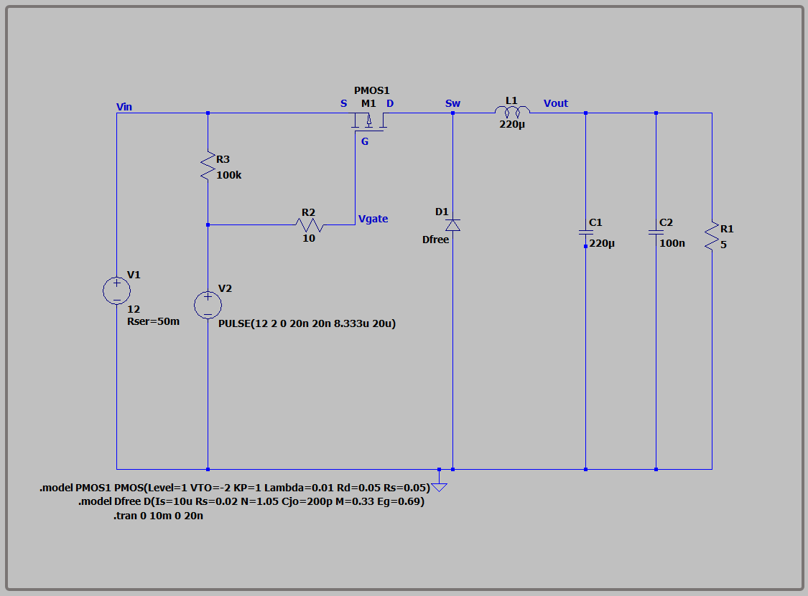
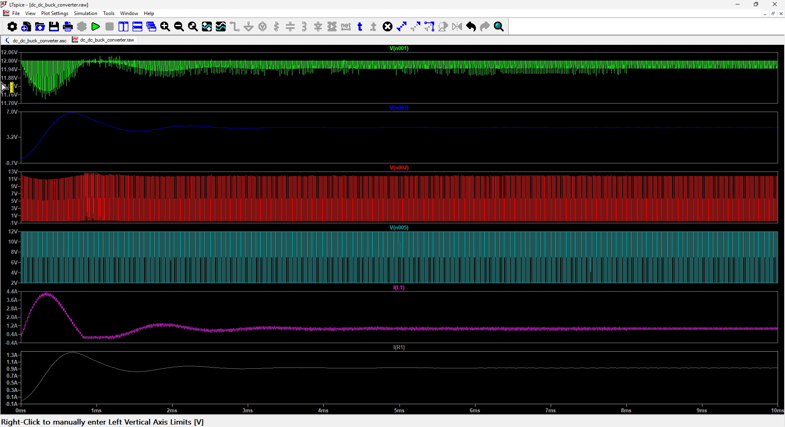

# 12 V to 5 V DC-DC Buck Converter

## Project Overview

This project involves the design and LTspice simulation of a non-isolated DC-DC buck converter that steps down a 12 V DC input supply towards a target output voltage of 5 V DC.

The converter operates at a switching frequency of 50 kHz and uses a high-side PMOS switching configuration.

The project explores switching behaviour, output voltage regulation, transient response, inductor current ripple, and the influence of practical component parasitics.

## Specifications

| Parameter | Value |
|---|---|
| Input Voltage | 12 V DC |
| Target Output Voltage | 5 V DC |
| Switching Frequency | 50 kHz |
| Switching Period | 20 µs |
| Load Resistance | 5 Ω |
| Inductor | 220 µH |
| Output Capacitor | 220 µF |
| High-frequency Capacitor | 100 nF |
| Switching Device | PMOS |
| Freewheeling Diode | Dfree |
| Simulation Software | LTspice |

## Circuit Configuration

The converter consists of the following components:

- A 12 V DC input supply.
- A high-side PMOS switching MOSFET.
- A freewheeling diode.
- A 220 µH power inductor.
- Parallel output filtering capacitors.
- A 5 Ω resistive load.

The PMOS periodically switches the input supply, while the inductor and output capacitors filter the resulting waveform to produce a lower DC output voltage.

## Circuit Schematic



## Component Parasitics

To introduce more realistic circuit behaviour, parasitic parameters were included in the simulation.

| Component | Parasitic Parameter | Value |
|---|---|---|
| Inductor | Series Resistance | 80 mΩ |
| Inductor | Parallel Capacitance | 10 pF |
| 220 µF Capacitor | ESR | 50 mΩ |
| 220 µF Capacitor | ESL | 5 nH |
| 100 nF Capacitor | ESR | 10 mΩ |
| Input Supply | Series Resistance | 50 mΩ |

These parasitic elements help investigate their influence on voltage regulation, current ripple, and transient response.

## Simulation Results

The LTspice transient simulation produced the following approximate observations:

| Parameter | Simulated Observation |
|---|---|
| Steady-state Output Voltage | Approximately 4.7–4.8 V |
| Inductor Current | Approximately 0.95 A |
| Load Current | Approximately 0.95 A |
| Startup Output Voltage Overshoot | Approximately 6.6 V |
| Operating Mode | Continuous Conduction Mode (CCM) |

The output voltage approaches the 5 V target but remains slightly below it. Further duty-cycle tuning and circuit optimisation may improve output regulation.

The startup overshoot also indicates the need to investigate transient response and startup behaviour during further development.

## Simulation Waveforms

The following image shows the simulated output waveform.



## Repository Structure

```text
DC-DC-Buck-Converter/
│
├── README.md
├── .gitattributes
├── .gitignore
│
├── sim/
│   └── dc_dc_buck_converter.asc
│
├── docs/
│   ├── circuit_schematic.png
│   └── waveform_steady_state.png
│
└── notes/
```

## Running the Simulation

1. Install [LTspice](https://www.analog.com/ltspice).
2. Clone or download this repository.
3. Navigate to the `sim/` directory.
4. Open `dc_dc_buck_converter.asc` using LTspice.
5. Run the transient simulation.
6. Inspect the output voltage, inductor current, and switching waveforms.

## Tools Used

- LTspice – Circuit design and simulation.
- Git – Version control.
- GitHub – Project hosting and documentation.

## Future Improvements

- Improve output voltage regulation towards 5 V.
- Investigate output voltage ripple.
- Compare ideal and parasitic component models.
- Study switching losses and converter efficiency.
- Explore alternative MOSFET configurations and gate-drive circuits.
- Investigate closed-loop voltage regulation.
- Evaluate component ratings and practical hardware implementation requirements.

## Project Status

**Status: Initial design and simulation completed.**

The converter has been designed and simulated in LTspice. Initial simulation observations have been documented. Further validation, optimisation, and design analysis remain ongoing.